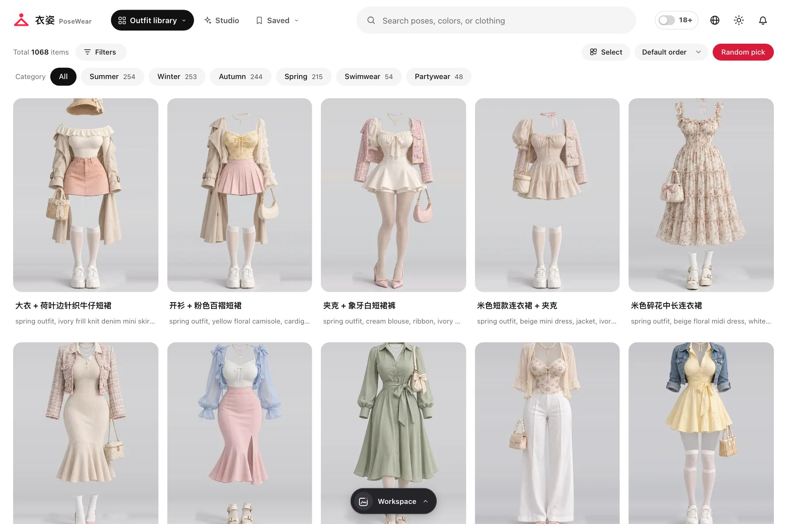
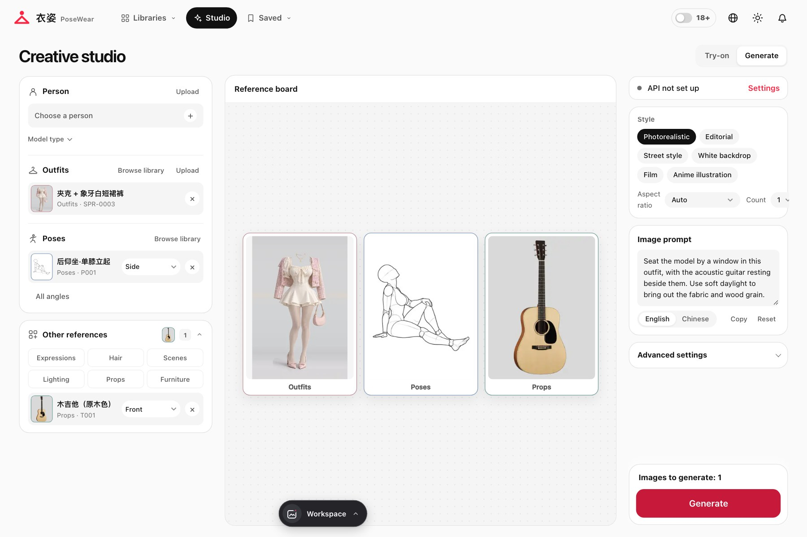
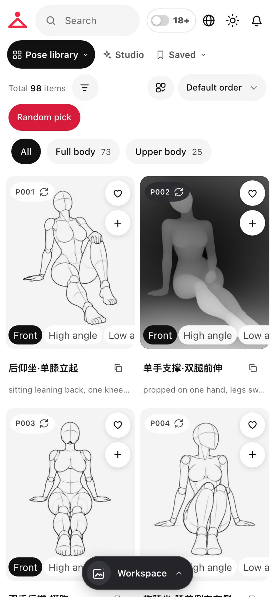
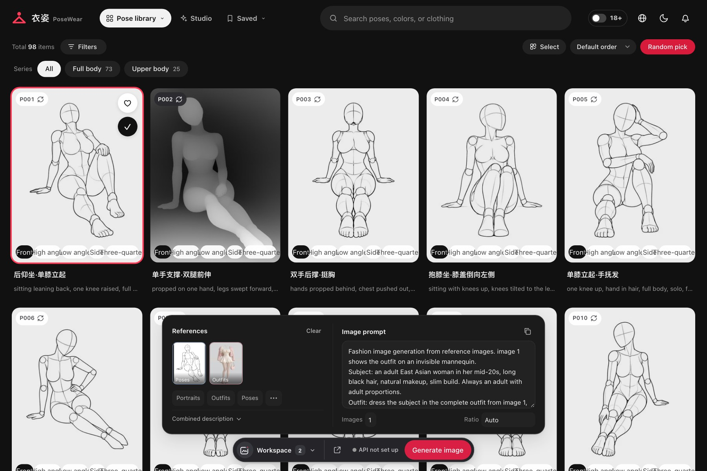

# PoseWear

[简体中文](README.md) · [English](README.en.md) · [日本語](README.ja.md)

Find visual references for drawing, photography and AI try-on. Pick a pose, flip it to the matching depth view and pair it with a portrait or outfit. Copy the prompt and image links into an agent, or generate an image in the studio.

[Open the gallery](https://posewear.pages.dev/) · [Run locally](#run-locally) · [Connect an agent](mcp/README.md) · [Release notes](CHANGELOG.md#en)



## Run locally

Use Node.js 22.12 or later. The preview fetches the 12 public catalogs on first visit and loads images as you browse. If you downloaded the source ZIP, open the extracted project directory and start at `npm ci`.

```sh
git clone https://github.com/atuizz/posewear.git
cd posewear
npm ci
npm start
```

Open the [local gallery](http://127.0.0.1:8787/). Browsing, saving favorites and copying references all work without an account or API key.

## From reference to image

| Where | What you can do |
| --- | --- |
| Gallery | Pick a camera angle at the foot of a pose card. Click the ID in the top left to flip to the corresponding depth map and back. Both sides of the same pose and angle can guide one generation. |
| Floating studio | Use the plus on a card to collect references. Keep the studio open as you browse or switch collections. Copying a single or combined prompt includes public image links for your selected views by default. Attach any locally uploaded photos separately when sharing. |
| Full studio | Pick any combination of person, outfit and pose. Open **Other references** for expressions, hairstyles, scenes, lighting, props or furniture. Use a single prop, start with text alone, or upload your photo for a before-and-after try-on. The studio remembers your edited prompt, image count and aspect ratio. |
| Generation history | Revisit a result, download it or export the images, prompts and settings as a ZIP. Each browser keeps up to 200 records. |



[See a try-on made from a portrait, outfit and pose](docs/banner.jpg)

The collection menu groups all 12 libraries into **Movement**, **People**, **Wardrobe** and **Setting**. You can pick references on mobile, too. The globe menu controls the interface language (Chinese, English or Japanese), description language (Chinese or English) and whether to include reference links when copying. Appearance follows your system by default. Choose light or dark mode in the header, and open the bell for updates and recent actions.

<table><tr><td width="28%" valign="top"></td><td valign="top"></td></tr></table>

## Choose how to generate

- **Cloud provider.** Enter your API key in the studio's provider settings. Use OpenAI, Gemini, Seedream or an HTTPS service compatible with the OpenAI, Gemini or xAI image protocol. Direct requests send the key, prompt and images to your provider. Enabling the proxy routes the same request through a Pages Function. Your provider sets pricing and quotas.
- **Local model.** Start ComfyUI, select it in the local studio, test the connection and choose an installed checkpoint. The built-in workflow takes one reference image. Supply your own workflow for multiple images, or start the preview with `POSEWEAR_LOCAL_ENGINE=sd-cpp npm start` to connect a stable-diffusion.cpp `sd-server`. [Local engine setup (Chinese)](docs/local-engines.md)
- **Agent.** From the repository root, run `codex mcp add posewear -- node "$PWD/mcp/server.mjs"` and start a new Codex session. Try “Find a side view of a seated pose, pair it with a spring outfit, and give me the prompt and both image links.” For another stdio client, use `node` as the command and the absolute path to `mcp/server.mjs` as its argument. [MCP configuration and tool examples (Chinese)](mcp/README.md) · [Reference selection skill](.agents/skills/posewear/SKILL.md)

Favorites, studio drafts and API keys live in your browser's localStorage. Generated images and their settings live in IndexedDB. Clearing the site's browser data removes both.

## Development and tests

The frontend uses plain JS, HTML and CSS. Python builds the static site. A Cloudflare Pages Function serves as an optional generation proxy. Use `npm start` to develop the interface. A full build from the original assets also requires Python 3.9+, Pillow, the source images and the extension archives.

Install the test browser with `npx playwright install chromium`, then run `npm run test:offline` for the fixture-based checks. For the full regression suite, start the staged Pages server as described in the handbook and run `U=http://127.0.0.1:8902 npm test` in the repository root. The browser tests mock image generation. [Asset preparation, builds and testing (Chinese)](AGENTS.md)

**v1.3.0 (2026-11-24)** Flip between matched line and depth views, keep selecting references in the open studio, and generate from a single material or just a prompt. This update also adds copyable reference links, three UI languages, local engines and MCP support. [Release notes](https://github.com/atuizz/posewear/releases/tag/v1.3.0) · [Changelog](CHANGELOG.md#en)

## License and credits

The code, UI copy and build scripts are available under the [MIT License](LICENSE). Each reference image, including images visible in the screenshots, retains its source terms. Keep source and author credits on self-hosted copies.

| Material | Source and terms |
| --- | --- |
| Poses, depth maps, outfits and anime outfits | By ギア / @giaaibusi. Contact the author about commercial use, reposting or redistribution. The repository includes Japanese depth metadata and PoseWear's Chinese names. Images are served by the asset CDN. [Line art](https://ai-pose-gallery.pages.dev/) · [Depth](https://ai-pose-depth-gallery.pages.dev/) · [Outfits](https://ai-costume-gallery.pages.dev/) · [Anime outfits](https://ai-costume-anime-gallery.pages.dev/) |
| Portraits | Fictional AI portraits by @agi_aibusi, released under CC0. The author asks users to avoid bulk reposting the originals. [AI Portrait Gallery](https://ai-portrait-gallery.pages.dev/) |
| Hairstyles and selected anime outfits | たき AI / CharaDB. Tags are CC0. Images belong to the author and are loaded directly from the original host. [CharaDB](https://charadb-2fi.pages.dev/) |
| Expressions | WaveSpeed AI Emotion Gallery, using ICT Face Model Light (© USC Institute for Creative Technologies, MIT). |
| Historical dress, scenes, lighting, props and furniture | Shisei / wquguru, CC0 1.0. |

Thanks to two open-source projects that inspired this work. [gen-ai-pose-image](https://github.com/wzc520pyfm/gen-ai-pose-image) · [nvzhuang](https://github.com/paipiange/nvzhuang)
