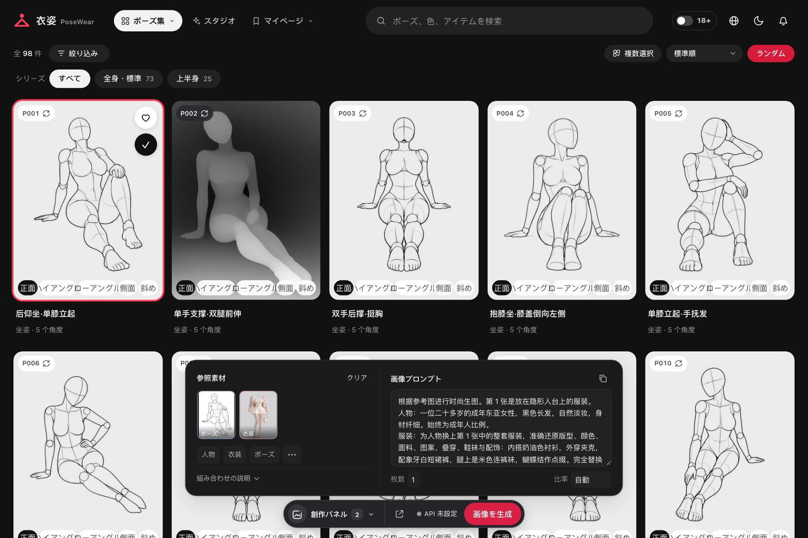

# 衣姿 PoseWear

[简体中文](README.md) · [English](README.en.md) · [日本語](README.ja.md)

作画、撮影、AI 試着のための参考画像を探せるギャラリーです。ポーズを選んで同じアングルの深度画像に切り替え、人物や衣装と組み合わせます。プロンプトと画像リンクをエージェントに渡したり、そのままスタジオで画像を生成したりできます。

[ギャラリーを開く](https://posewear.pages.dev/) · [ローカルで起動](#ローカルで起動) · [エージェントと接続](mcp/README.md) · [更新履歴](CHANGELOG.md#ja)


## ローカルで起動

Node.js 22.12 以降を使用します。プレビューの初回アクセス時に公開カタログ 12 件を取得し、画像は閲覧に合わせて読み込みます。ソースの ZIP を入手した場合は、展開したプロジェクトのディレクトリで `npm ci` から実行してください。

```sh
git clone https://github.com/atuizz/posewear.git
cd posewear
npm ci
npm start
```

[ローカルのギャラリー](http://127.0.0.1:8787/)を開きます。閲覧、お気に入り登録、参考画像リンクのコピーにはアカウントも API キーも不要です。

## 素材を選んで画像を作る

| 場所 | できること |
| --- | --- |
| 素材ライブラリ | ポーズカードの下部でアングルを選択。左上の番号を押すと、同じアングルの線画と深度画像を切り替えられます。同じポーズ・アングルの両方を生成時に使えます。 |
| フローティングスタジオ | カードの「＋」で素材を追加します。スタジオを開いたまま別の素材やライブラリを選べます。単体・組み合わせのどちらも、プロンプトをコピーすると選択したアングルの画像 URL が付きます。アップロードした手元の写真は別途添付してください。 |
| スタジオ | 人物・衣装・ポーズを自由に組み合わせられます。表情、髪型、背景、照明、小物、家具は「その他の素材」から選択。小物一つ、あるいは文章だけでも生成できます。編集したプロンプト、枚数、縦横比は次回も引き継がれます。試着では、自分の写真と生成結果を見比べられます。 |
| 生成履歴 | 結果を見直して保存したり、画像・プロンプト・設定をまとめて ZIP で書き出したりできます。保存件数はブラウザーごとに最大 200 件です。 |


[人物・衣装・ポーズを組み合わせた試着例](docs/banner.jpg)

素材メニューでは 12 のライブラリを「動作」「人物・髪型」「衣類」「空間・小物」の四つに分類しています。スマートフォンからも素材を選べます。地球のアイコンから表示言語（中・英・日）、素材の説明言語（中・英）、コピー時の画像リンクの有無を設定できます。外観は初期設定でシステムに合わせます。ヘッダーではライト・ダークを指定でき、ベルから更新や直近の操作を確認できます。

<table><tr><td width="28%" valign="top"></td><td valign="top"></td></tr></table>

## 生成方法を選ぶ

- **クラウドサービス。** スタジオのプロバイダー設定に自身の API キーを入力します。OpenAI、Gemini、Seedream のほか、OpenAI・Gemini・xAI の画像 API と互換性のある HTTPS サービスを利用できます。直接接続ではキー、プロンプト、画像が選択したサービスに送られます。プロキシを有効にすると Pages Function が同じ内容を転送します。料金と利用上限は各サービスの規定に従います。
- **ローカルモデル。** ComfyUI を起動してローカルのスタジオで選択し、接続テスト後にインストール済みのチェックポイントを指定します。付属ワークフローは参考画像 1 枚に対応します。複数枚には独自のワークフローを使用できます。stable-diffusion.cpp の `sd-server` を使う場合は `POSEWEAR_LOCAL_ENGINE=sd-cpp npm start` でプレビューを起動します。[ローカルエンジンの設定（中国語）](docs/local-engines.md)
- **エージェント。** リポジトリのルートで `codex mcp add posewear -- node "$PWD/mcp/server.mjs"` を実行して、新しい Codex セッションを開きます。例えば「横から見た座りポーズと春服を探して、プロンプトと参考画像 2 枚のリンクをください」と依頼できます。ほかの stdio クライアントでは、コマンドに `node`、引数に `mcp/server.mjs` の絶対パスを指定します。[MCP の設定とツール例（中国語）](mcp/README.md) · [素材選択の Skill](.agents/skills/posewear/SKILL.md)

お気に入り、スタジオの下書き、API キーはブラウザーの localStorage、生成履歴は IndexedDB に保存されます。サイトのブラウザーデータを消去すると、これらの内容も削除されます。

## 開発とテスト

フロントエンドは素の JS、HTML、CSS で、Python が静的サイトをビルドします。生成用のプロキシには Cloudflare Pages Function を使えます。画面の開発には `npm start` を使用します。原画からの完全なビルドには Python 3.9 以降、Pillow、元画像、拡張素材アーカイブが必要です。

`npx playwright install chromium` でテスト用ブラウザーをインストールし、`npm run test:offline` でフィクスチャを使うテストを実行できます。全回帰テストを実行する場合は、開発手順に従ってステージングの Pages サーバーを起動し、リポジトリのルートで `U=http://127.0.0.1:8902 npm test` を実行します。ブラウザーテストは画像生成サービスの応答を模擬します。[素材準備、ビルドとテスト手順（中国語）](AGENTS.md)

**v1.3.0（2026-11-24）** 対応する線画と深度画像の切り替え、スタジオを開いたままの素材選択、素材単体またはプロンプトだけでの生成に対応しました。参考画像リンク付きコピー、3 言語の UI、ローカルエンジン、MCP も利用できます。[リリースノート](https://github.com/atuizz/posewear/releases/tag/v1.3.0) · [更新履歴](CHANGELOG.md#ja)

## ライセンスと謝辞

コード、画面の文言、ビルドスクリプトには [MIT ライセンス](LICENSE) が適用されます。スクリーンショット内の画像を含め、素材にはそれぞれの提供元の利用条件が適用されます。セルフホストの際は出典と作者名を残してください。

| 素材 | 出典と利用条件 |
| --- | --- |
| ポーズ、深度画像、衣装、アニメ衣装 | ギア / @giaaibusi。商用利用、転載、再配布については作者にご確認ください。リポジトリには深度画像の日本語メタデータと本サイトの中国語訳を収録し、画像は素材 CDN から配信しています。[線画](https://ai-pose-gallery.pages.dev/) · [深度画像](https://ai-pose-depth-gallery.pages.dev/) · [衣装](https://ai-costume-gallery.pages.dev/) · [アニメ衣装](https://ai-costume-anime-gallery.pages.dev/) |
| 人物 | @agi_aibusi による架空の AI ポートレート、CC0。作者は原画の一括転載を控えるよう希望しています。[AI Portrait Gallery](https://ai-portrait-gallery.pages.dev/) |
| 髪型・一部のアニメ衣装 | たき AI / CharaDB。タグは CC0。画像の権利は作者に帰属し、提供元から直接読み込みます。[CharaDB](https://charadb-2fi.pages.dev/) |
| 表情 | WaveSpeed AI Emotion Gallery。ICT Face Model Light を使用（© USC Institute for Creative Technologies、MIT）。 |
| 歴代衣装、背景、照明、小物、家具 | Shisei / wquguru、CC0 1.0。 |

着想をいただいた二つのオープンソースプロジェクトに感謝します。[gen-ai-pose-image](https://github.com/wzc520pyfm/gen-ai-pose-image) · [nvzhuang](https://github.com/paipiange/nvzhuang)
