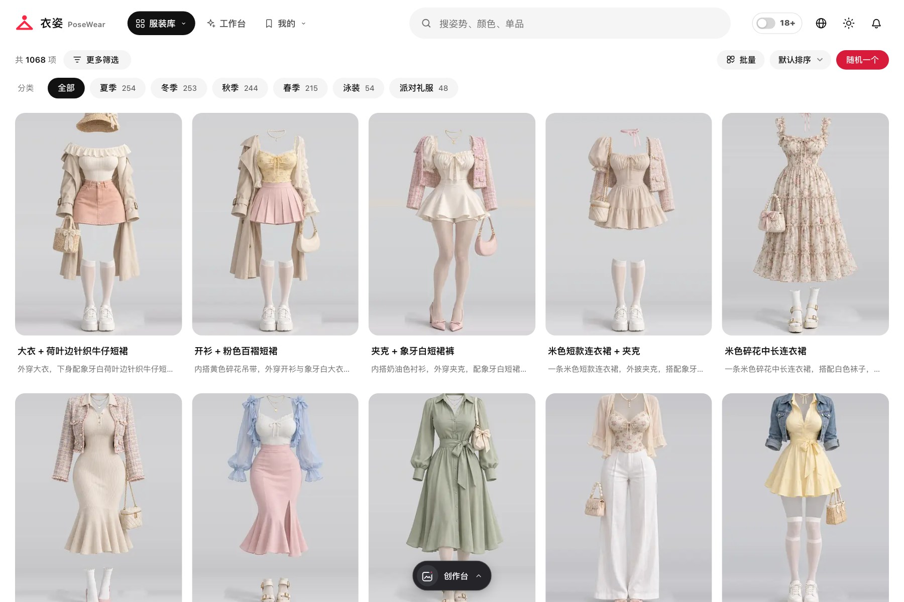
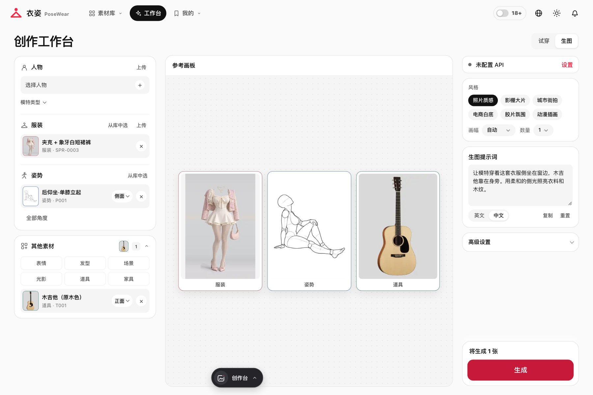
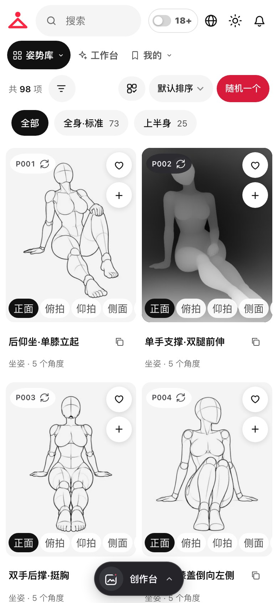
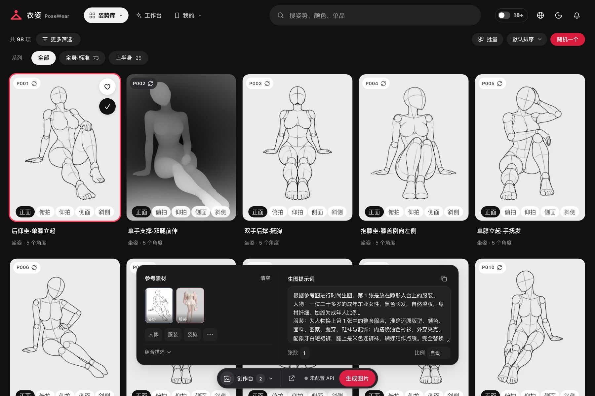

# 衣姿 PoseWear

[简体中文](README.md) · [English](README.en.md) · [日本語](README.ja.md)

给绘画、摄影和 AI 试穿挑参考图。从一个动作开始，翻到同机位的深度图，搭配人物与服装，再把提示词和参考图链接一起交给智能体，或直接在工作台生成图片。

[打开在线图库](https://posewear.pages.dev/) · [本地启动](#本地启动) · [接入智能体](mcp/README.md) · [版本记录](CHANGELOG.md#zh)



## 本地启动

需要 Node.js 22.12 或以上版本。首次访问会联网载入 12 份公开素材目录，图片按需加载。已下载源码 ZIP 时，进入解压后的项目目录，从 `npm ci` 开始。

```sh
git clone https://github.com/atuizz/posewear.git
cd posewear
npm ci
npm start
```

打开[本地图库](http://127.0.0.1:8787/)。浏览、收藏和复制参考图均无需账号或 API 密钥。

## 从选图到出图

| 在哪里 | 可以做什么 |
| --- | --- |
| 素材库 | 在姿势卡片底部选择机位，点左上角编号可翻到对应深度图，再点一次回到线稿。同一动作、同一角度的两面可一起用于生成。 |
| 悬浮工作台 | 点卡片上的加号收集素材。展开底部创作条后也能继续浏览和换库。复制单条或组合提示词时，默认附上所选视角的公开图片直链；转发时请另附本地上传的照片。 |
| 完整工作台 | 人物、服装、姿势可以自由组合；表情、发型、场景、光影、道具和家具集中在「其他素材」。可以只用一个道具，也可以只写提示词。工作台会记住手改的提示词、张数和比例。试穿时可上传自己的照片对比成品。 |
| 我的 → 生成记录 | 查看成品、下载图片，或将图片、提示词与参数打成 ZIP。当前浏览器最多保存 200 条记录。 |



[查看人物、服装和姿势组合后的试穿示例](docs/banner.jpg)

图库将 12 个库按姿态、人物造型、服饰、环境与物件归为四组。手机也可直接选图。地球图标可分别设置界面语言（中、英、日）与素材描述语言（中、英），以及复制时是否附图链。外观默认跟随系统，可在页头切换浅色或深色；铃铛集中显示更新和操作提示。

<table><tr><td width="28%" valign="top"></td><td valign="top"></td></tr></table>

## 选择生成方式

- **云端服务。** 在工作台的服务商设置中填写自己的密钥。支持 OpenAI、Gemini、豆包 Seedream 及兼容 OpenAI、Gemini、xAI 图片协议的 HTTPS 服务。直连会将密钥、提示词和图片送往所选服务；启用代理时由本站 Pages Function 转发。费用和配额由服务商决定。
- **本机模型。** 启动 ComfyUI，在本地工作台选择「ComfyUI」，测试连接并选取已安装的 checkpoint。内置工作流接受一张参考图；多图可以接入自定义工作流。使用 stable-diffusion.cpp 的 `sd-server` 时，以 `POSEWEAR_LOCAL_ENGINE=sd-cpp npm start` 启动预览。[本机引擎配置](docs/local-engines.md)
- **交给智能体。** 在仓库根目录运行 `codex mcp add posewear -- node "$PWD/mcp/server.mjs"`，新开会话即可让智能体搜索素材、按角度取图和组合提示词。例如「找一个侧面的坐姿，配一套春装，给我提示词和两张参考图的链接」。其他 stdio 客户端可用 `node` 启动仓库中的 `mcp/server.mjs`（填写绝对路径）。[MCP 设置与示例](mcp/README.md) · [选图 Skill](.agents/skills/posewear/SKILL.md)

收藏、工作台草稿与 API 密钥保存在当前浏览器的 localStorage，生成记录保存在 IndexedDB。清除站点数据会一并删除这些内容。

## 开发与测试

界面使用原生 JS、HTML 和 CSS，Python 负责构建静态站，Cloudflare Pages Function 提供可选的生成代理。开发界面直接使用 `npm start`。从原图构建完整站点还需要 Python 3.9+、Pillow、原始素材及扩展库档案。

运行 `npx playwright install chromium` 安装测试浏览器。运行 `npm run test:offline` 可用本地测试素材执行回归。完整测试需按开发手册启动 staging 服务，再在仓库根目录执行 `U=http://127.0.0.1:8902 npm test`。浏览器回归使用模拟的生图服务响应。[构建、素材准备与测试步骤](AGENTS.md)

**v1.3.0（2026-11-24）** 姿势与深度图可在原位翻面，悬浮工作台支持连续选材，完整工作台支持单素材与纯提示词生图。新增携图复制、三语界面、本机引擎与 MCP。[发布说明](https://github.com/atuizz/posewear/releases/tag/v1.3.0) · [历史版本](CHANGELOG.md#zh)

## 许可与致谢

代码、界面文案和构建脚本采用 [MIT](LICENSE)。素材及截图中的图片各有其来源与使用条件。自建站请保留来源与作者说明。

| 素材 | 来源与使用条件 |
| --- | --- |
| 姿势、深度姿势、服装、动画服装 | ギア / @giaaibusi。商用、转载、二次分发请向作者确认。仓库收录深度姿势日文文本及本站中文译名，图片由素材 CDN 分发。[线稿](https://ai-pose-gallery.pages.dev/) · [深度图](https://ai-pose-depth-gallery.pages.dev/) · [服装](https://ai-costume-gallery.pages.dev/) · [动画服装](https://ai-costume-anime-gallery.pages.dev/) |
| 人像 | @agi_aibusi 的虚构 AI 人像，CC0。作者希望避免原样批量转载。[AI Portrait Gallery](https://ai-portrait-gallery.pages.dev/) |
| 发型与部分动画服装 | たき AI / CharaDB，标签为 CC0。图片归作者所有，直接从原站加载。[CharaDB](https://charadb-2fi.pages.dev/) |
| 表情 | WaveSpeed AI Emotion Gallery；使用 ICT Face Model Light 头模（© USC Institute for Creative Technologies，MIT）。 |
| 历代服饰、场景、光影、道具、家具 | Shisei / wquguru，CC0 1.0。 |

感谢两个开源项目带来的灵感。[gen-ai-pose-image](https://github.com/wzc520pyfm/gen-ai-pose-image) · [nvzhuang](https://github.com/paipiange/nvzhuang)
